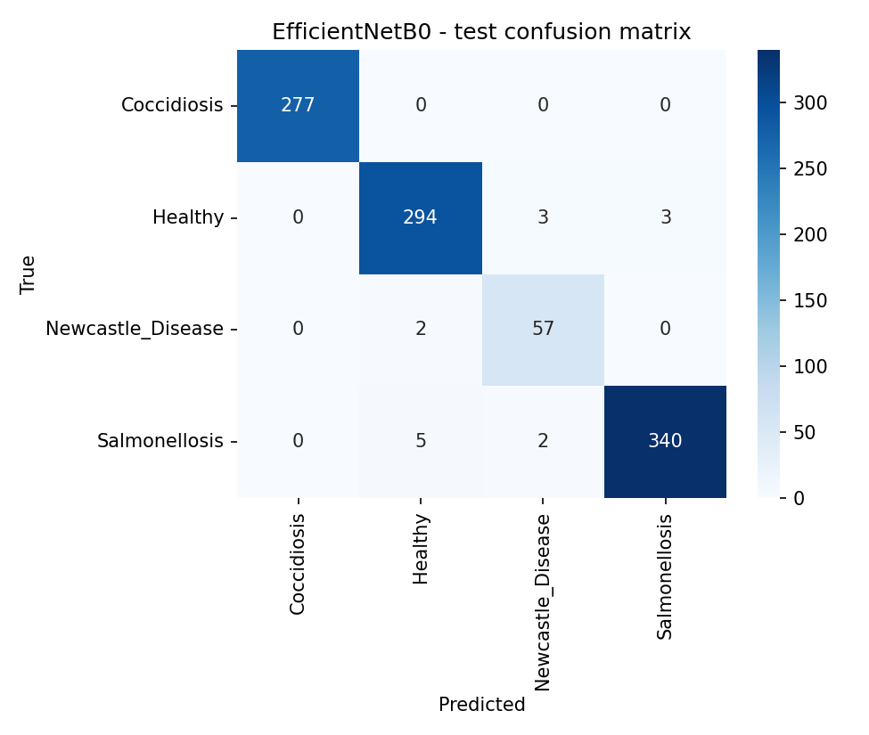
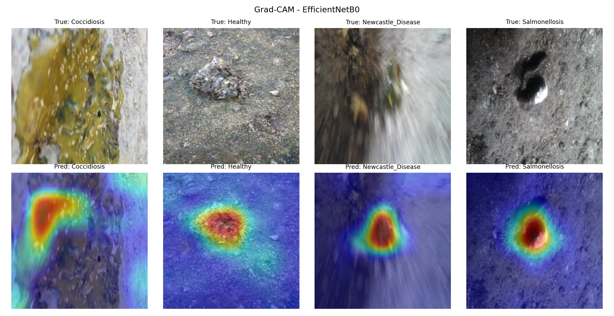

# Poultry Disease Classification from Fecal Images

Four-class screening system for poultry disease from fecal images: **Coccidiosis, Healthy, Newcastle disease, Salmonellosis**. It includes a poultry-vs-other-animal rejection gate (CLIP + Mahalanobis distance) and a Gradio web app.

> Research prototype for an IDSE project. Not a substitute for laboratory diagnosis.

## Results

Selected model: **EfficientNetB0**, **98.47% test accuracy** on a leakage-free, group-aware split (n = 983).

| Model | Val Accuracy | Macro F1 | Latency (ms) | Size (MB) |
|---|---|---|---|---|
| **EfficientNetB0** | 0.9875 | 0.9812 | 81.6 | 43.4 |
| DenseNet169 | 0.9847 | 0.9807 | 239.4 | 92.7 |
| ResNet50 | 0.9847 | 0.9793 | 214.2 | 227.8 |
| MobileNetV2 | 0.9559 | 0.9297 | 46.9 | 26.2 |




Full details: [reports/IDSE_FINAL_REPORT](reports/IDSE_FINAL_REPORT_UPDATED.md)

## Repository structure

```
├── Poultry_Disease_Classification_FINAL.ipynb   # training, evaluation, Grad-CAM (built for Google Colab)
├── app/                                         # Gradio web app + bundled EfficientNetB0 model
├── reports/                                     # metrics, robustness, training summaries, final report
├── plots/                                       # learning curves, confusion matrix, Grad-CAM, EDA
├── checkpoints/                                 # EfficientNetB0, DenseNet169, MobileNetV2 (.keras)
├── final_model/                                 # EfficientNetB0 SavedModel
├── splits/                                      # train / val / test split CSVs
└── manifests/                                   # dataset manifest (hashes, cluster ids)
```

## Run the web app

Requires Python 3.13.

```bash
cd app
python -m venv venv
venv\Scripts\activate        # Windows  (Mac/Linux: source venv/bin/activate)
pip install -r requirements.txt
python app.py
```

Open http://localhost:7860

- Set `USE_CLIP=0` to skip the CLIP gate (faster start, less RAM).
- Docker: `cd app && docker build -t poultry . && docker run -p 7860:7860 poultry`

## Reproduce the training

1. Download the dataset from Zenodo (record 4628934, resized 256 version). Images are not included in this repo.
2. Place it in Google Drive under `MyDrive/IDSE_Dataset`.
3. Open the notebook in Google Colab (GPU runtime) and run all cells.

## Trained checkpoints

`checkpoints/` contains EfficientNetB0, DenseNet169 and MobileNetV2. `ResNet50_best.keras` (228 MB) exceeds GitHub's 100 MB file limit, so it is hosted on Google Drive together with all other models:
**[Download from Google Drive](https://drive.google.com/drive/u/0/folders/1nDH5rTYLGrc8nzjDmcmC16Dz7DBc6ami)**

## Author

L.SHASHANK REDDY -CS24B1010
M.V.N.SATHVIK - CS24B1034
N.JAGAN MOHAN REDDY - CS24B1038
B.PARDHU YADAV - CS24B1051
